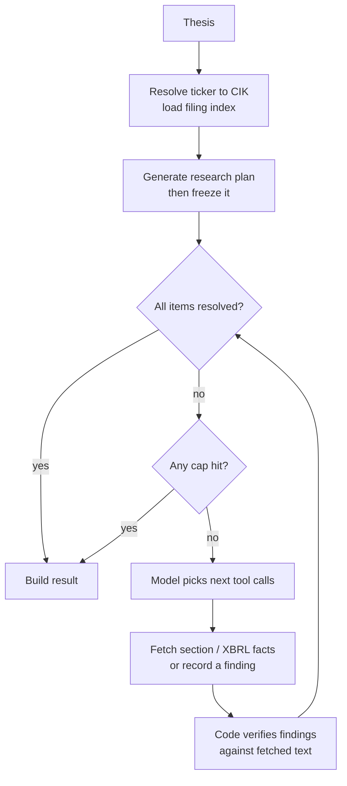

# Equity Research Assistant

Takes an investment thesis and produces an analyst memo where every number and every quote traces back to an SEC filing, and everything that couldn't be verified is listed as a gap instead of being filled in.

## Why I built it

A friend works in banking and trades on the side. He can explain a thesis in two minutes, but writing it up properly takes him six to ten hours, so most of his theses never get written down. He is the domain expert and end user for this project, and he reviews what gets built.

The harder problem underneath is that a thesis stated out loud is a bundle of claims, assumptions, and vibes. Checking those claims against what a company actually filed is most of the work of research, and that is the part this project automates.

## How it works

The core is a research agent with a real plan-act-observe loop. Given a structured thesis, it writes a research plan, decides which SEC filing to pull, reads what comes back, and decides whether the plan is satisfied or it needs another pull. It stops when every plan item is resolved or when it hits a cap, and it records which. That loop is the piece being built now. What is done and tested is the schema it has to produce, which is where several of the constraints below are enforced.

## Status

Last updated: 2026-10-19

| Piece | State |
|---|---|
| Design: loop control flow, tool interface, output schema | Done |
| Schema layer (`core/result.py`, `agents/research/`) | Done, tested |
| EDGAR client, model adapter, research loop, verification | In progress |
| Thesis input, orchestrator, memo output | Not started |

## Design decisions

These are the parts I'd want a reviewer to push on. Each one has a full record in [`docs/decisions/`](docs/decisions/).

**The model's claims aren't trusted until code checks them.** A plan item counts as found only if the cited filing was actually fetched during this run *and* the quoted text appears verbatim in what was fetched. Without that check, a model that reports success is indistinguishable from one that made it up.

**The model never types a number.** When it cites a financial figure, it points at a handle (`F17`) for a fact it retrieved, and code copies the value, tag, and period from the source data. That removes transcription errors. It doesn't remove picking the wrong metric, so the tag and its human-readable label are carried into the memo where a reviewer can see them.

**"Unavailable" is a valid answer, but it has to be earned.** Marking an item unavailable requires citing the fetches that came up empty, or showing the company filed no such document in the window. Otherwise the cheapest way to finish is to give up on everything in the first iteration.

**The plan is frozen.** Once generated, plan items can't be edited, added, or removed. The loop can only change an item's status. A plan the agent can rewrite mid-run lets it quietly drop whatever it couldn't find.

**Every way the loop can stop is recorded separately.** Plan satisfied, iteration cap, token budget, wall clock, stalled, repeated tool failures, model error, model refusal. "Ran out of budget before checking" and "checked and it isn't there" are different results and the memo says which.

**Failures are handled per tool call.** A 404 on one filing doesn't end the run. Transient errors retry inside the tool. Permanent errors go back to the model as information, and they count as evidence for "unavailable". Five failures in a row stop the run, because at that point EDGAR is probably down.

**Cost is measured, not guessed.** The token cap counts new work only (output plus uncached input). Prompt caching keeps the growing conversation history cheap to re-send, and every run reports an estimated dollar cost.

**Provider details sit behind an adapter.** The loop never calls the Anthropic SDK directly. Caching, strict tool schemas, and structured outputs live in one place, so comparing models (or providers) is a config change.

## Architecture

Four layers: input, orchestration, agents, output. Agents never know about each other, and the orchestrator never touches raw data. Every agent returns the same envelope (`AgentResult`): a status the orchestrator can branch on, the reason the run ended, the payload, and an explicit list of gaps.



## How I work

I use Claude Code for work that is mechanical and checkable, not for work where the judgment lives. Every decision in [`docs/decisions/`](docs/decisions/) is mine, with the reasoning recorded when I made it. Where I generated code, I reviewed it against the decision record it was meant to implement, and anything I could not explain line by line got rewritten.

## Stack

- Python 3.12, managed with [uv](https://docs.astral.sh/uv/)
- Anthropic SDK (Claude, with native tool use). Developing on Claude Sonnet; the final model will be chosen by comparing quality and cost on real theses.
- SEC EDGAR: company submissions, filing documents, XBRL company facts
- pytest

## Running it

Only the tests run today.

```bash
uv sync
uv run pytest -q
```
